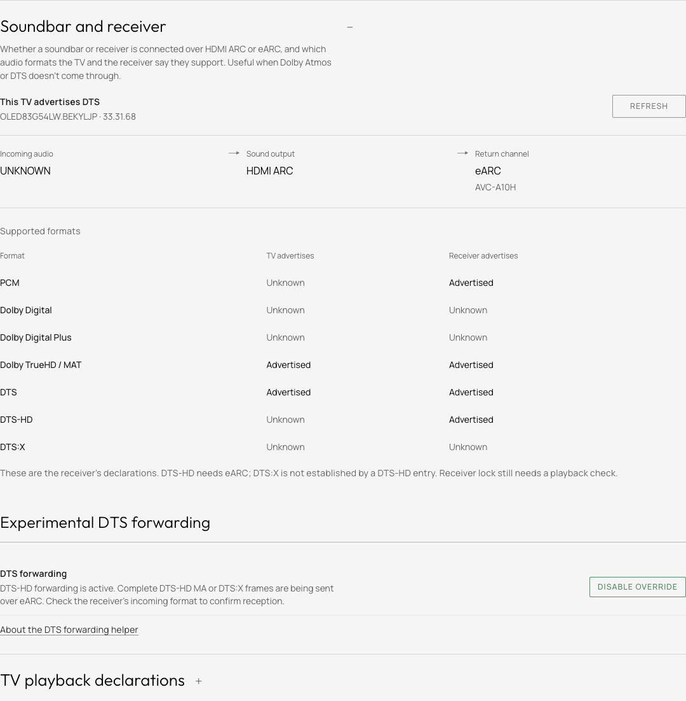
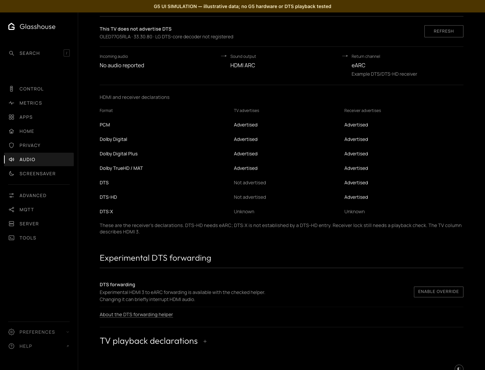

# Audio

The Audio tab gathers the TV's sound settings, what the TV and its receiver
report about audio formats, and the experimental DTS forwarding switch. The
TV app has the same tab, with the same rows in the same order.

## Sound

LG's own sound settings: sound output, sound mode, digital sound output,
balance, automatic volume levelling, eARC and Bluetooth speaker mode, then each
HDMI input's audio format. Sound mode and balance apply to the TV speakers
only. Pass Through and Bitstream request encoded audio; PCM requests decoded
audio. As in LG's menu, only the input on screen can have its audio format
changed.

## Soundbar and receiver

Whether a soundbar or receiver is connected over HDMI ARC or eARC, and which
audio formats the TV and the receiver say they support: useful when Dolby Atmos
or DTS doesn't come through. On the web tab it is folded under Sound; the TV
app lists it below Sound.
The audio coming in, where the TV sends it, and the return channel it has
negotiated with the receiver (ARC, eARC or none). The negotiated link is
separate from the eARC setting.

Below it, each format as the TV advertises it to the current HDMI source, and
as the ARC or eARC receiver advertises it. Unknown stays unknown when the TV
does not report a value. A DTS-HD entry does not establish DTS:X. A listed
format is not proof of working pass-through; the receiver's incoming-signal
display confirms what arrives.

**TV playback declarations** lists the formats and channel limits in LG's
media configuration for apps on the TV. They describe playback, not what
reaches a receiver.

## Experimental DTS forwarding

Controls a separately installed
[lg-g5-dts helper](https://github.com/dakenf/lg-g5-dts/tree/ac5f3e3e1d7f034ad1f35c43ae7c722aeae798ae).
It is offered only for the pinned prebuilt package on an OLED77G5RLA with
firmware 33.30.80 and kernel `5.4.268-329.ptl4tv.5`, forwarding HDMI 3 over
eARC. Before enabling it, Glasshouse checks the model, firmware, kernel, the
helper's manifest, runtime files and boot hook, that the output is HDMI ARC
with Pass Through, and that the receiver advertises DTS and DTS-HD. The helper
handles both; a receiver with DTS alone needs a separately qualified helper.
Other TVs and builds are refused. Glasshouse does not download or install the
helper.

Enabled and active are separate states: the switch shows whether the helper is
running, and its description whether it reports an active forwarding route.
Switching off runs the helper's full restoration, which can interrupt HDMI
audio briefly. Enabling takes two presses; disabling takes one.

A separate native-app profile is available on OLED83G54LW.BEKYLJP firmware
33.31.68 with the matching native forwarding package installed. The default
mode forwards 48 kHz DTS core. An opt-in HD mode forwards complete DTS-HD MA
and DTS:X frames on an eight-channel 192 kHz HBR carrier. The mode is selected
with the package's `control.py mode core|hd` command before playback; the
switch enables or disables the selected mode for the shared TV media service.
It requires HDMI ARC output, Pass Through and receiver DTS support. HD mode
also requires an active eARC link and receiver DTS-HD support. Enabling
restarts TV media playback.

The description distinguishes preparation, active HD payload and a core-only
source. It reports the TV's forwarding state; the receiver's incoming-signal
display confirms reception. HD starts and recovers with silence until the
output has settled. Frames that exceed the carrier capacity stop playback
rather than silently dropping the HD extensions.

The native carrier, shared LG player and Plex app were tried in core mode on
that G5 with an AVC-A10H. Casino direct-played its DTS-HD track without
transcoding while the receiver reported DTS core. Seek, pause/resume, a
notification, end-of-stream, player-crash recovery and disabling/re-enabling
the control were checked. HD mode reached the same receiver as DTS:X from a
raw carrier and a native LG media-service clip. Plex Casino also direct-played its MA/DTS:X track with DTS:X reception through
seek, a notification and a 24-second pause/resume. Ordinary ARC and other
firmware remain unqualified.

This capture is from the supported Cinema G5 during native HD playback. The
status describes frames sent by the TV; receiver identification was checked
separately. Active disable/re-enable, forced player termination, the next
player's HD recovery and subsequent 48 kHz PCM output were also checked.

The helper's upstream trial recorded DTS and DTS:X on that exact 77-inch G5,
with a Ugoos SK1 source and Samsung HW-Q950A receiver. That result does not
qualify the Glasshouse integration or a different G5 size, firmware or kernel.
The forwarding route uses the TV's existing DSP; it does not add a TV-app DTS
decoder. A G5 model name alone does not enable the switch.

This G5 screenshot uses illustrative data to show the control. It is not a
capture from a G5 or evidence of DTS reaching a receiver.

A failed reading removes the web tab's controls until a successful refresh.
Readings started before a forwarding change cannot replace its result.
