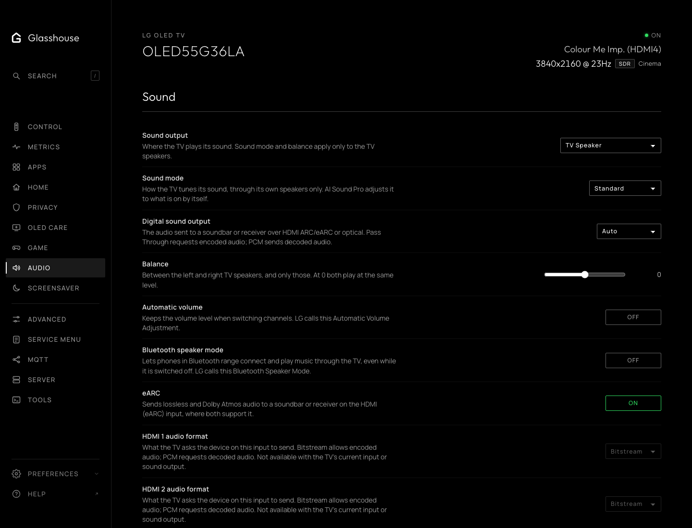
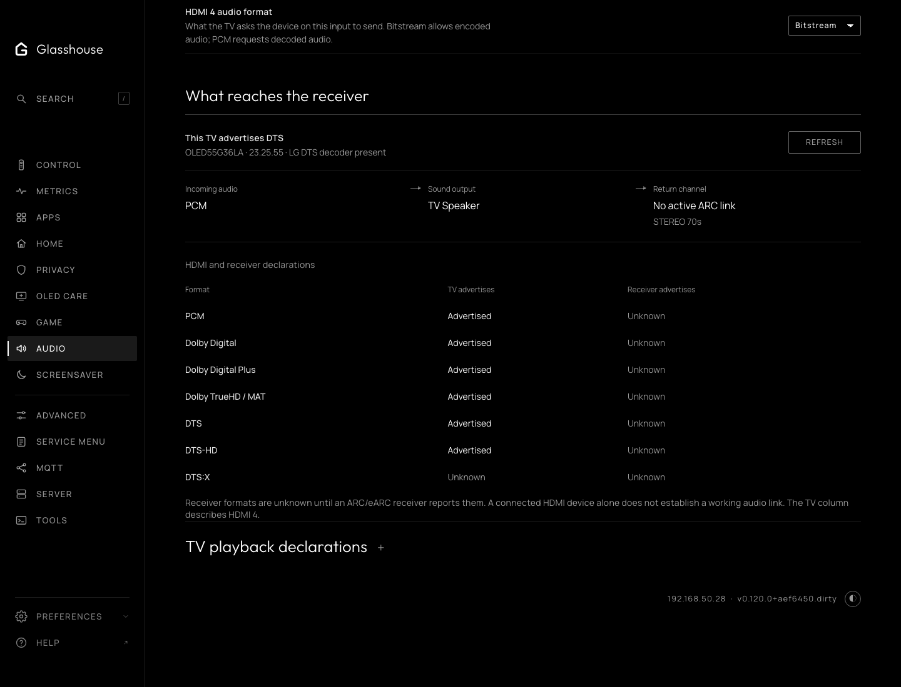

# Audio

The Audio tab gathers the TV's sound settings and what the TV and its receiver
report about audio formats. The TV app has the same tab, with the same rows in
the same order.

## Sound

LG's own sound settings: sound output, sound mode, digital sound output,
balance, automatic volume levelling, eARC and Bluetooth speaker mode, then each
HDMI input's audio format. Sound mode and balance apply to the TV speakers
only. Pass Through and Bitstream request encoded audio; PCM requests decoded
audio. As in LG's menu, only the input on screen can have its audio format
changed.

## What reaches the receiver

The audio coming in, where the TV sends it, and the return channel it has
negotiated with the receiver (ARC, eARC or none). The negotiated link is
separate from the eARC setting.

Below it, each format as the TV advertises it to the current HDMI source, and
as the ARC or eARC receiver advertises it. Unknown stays unknown when the TV
does not report a value. A DTS-HD entry does not establish DTS:X. A listed
format is not proof of working pass-through; the receiver's incoming-signal
display confirms what arrives.

**TV playback declarations** lists the formats and channel limits in LG's
media configuration for apps on the TV. They describe playback, not what
reaches a receiver.

A failed reading removes the web tab's controls until a successful refresh.
