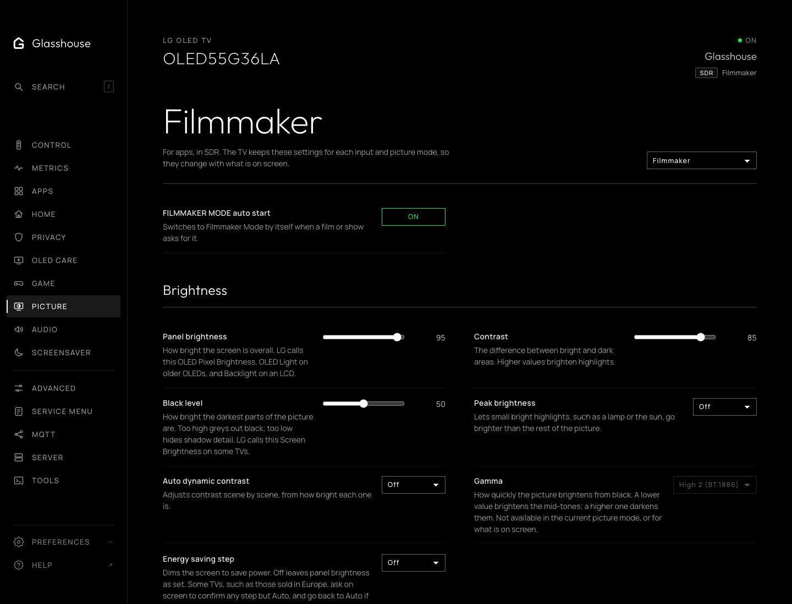
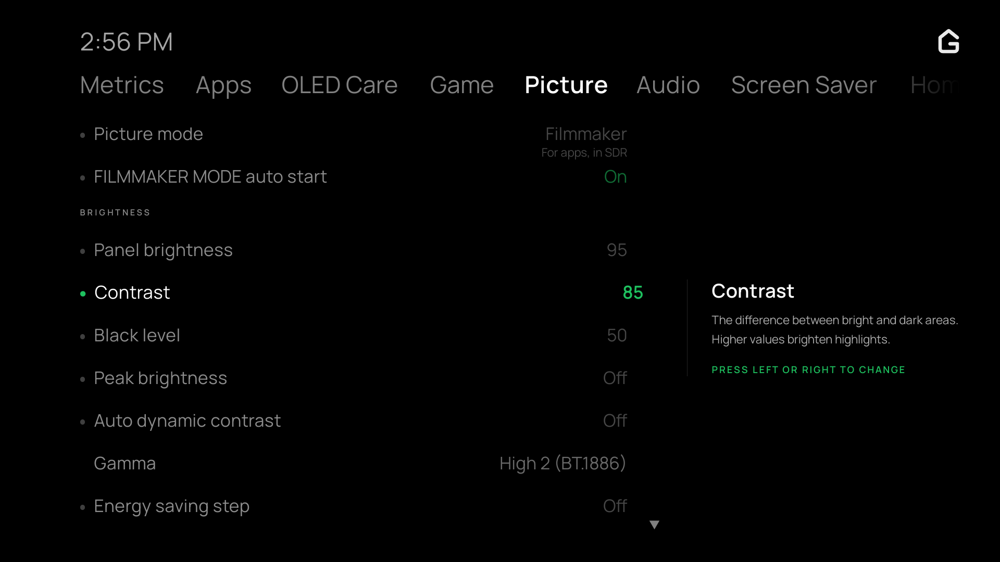

# Picture

The Picture tab gathers LG's picture settings in one place, grouped as LG's own
Picture menu groups them: brightness, colour, clarity, motion and aspect ratio,
with white balance and colour management folded below. The TV app has the same
tab.

## The picture on screen

LG keeps a picture mode, and every adjustment to it, for each input. The tab
shows and changes the settings of the picture on screen: its mode heads the
tab, with the input and dynamic range they belong to, such as HDMI 4 in SDR,
or apps in Dolby Vision. Switching input or mode with the remote changes what
the tab shows within a few seconds.

A change marks the mode as adjusted, as LG's menu does, so LG's own **Reset**
puts it back.

## What each TV shows

Which settings appear, the choices each offers and each slider's range come
from the TV itself, so a TV shows what its own menu has: Local Dimming only on
an LCD, Dynamic Tone Mapping only for HDR video, Video Range only on an HDMI
input. A setting LG greys out, such as Gamma in Filmmaker Mode, is greyed out
here too and cannot be changed. Aspect ratio, Just Scan and TruMotion are kept
for each app and input, and show while video is on screen.

Hidden settings and choices LG marks inactive cannot be written. If a change
is refused, the web tab restores the value read from the TV.

Screen Off in the energy saving step is not offered, as it blanks the screen.
Some TVs, such as those sold in Europe, ask on screen to confirm any other step
but Auto, and go back to Auto if it is cancelled there.
While Gallery is on screen the picture is locked.

## On the TV

In the TV app, Left and Right step a slider as in LG's menu; the value is sent
once the presses stop. OK cycles a choice or switches a setting.
Adjustments to different rows made in quick succession are all saved.

